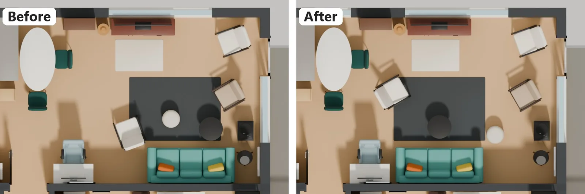

I wanted to try a few furniture layouts without dragging a sofa around the flat. So I sent my AI agent a floor plan and 13 phone photos and asked it to rebuild the place in 3D.

About 70 minutes later I had a 3D model of the whole flat and a planner that opens in the browser. I can drag every piece of furniture, see when something hits a wall or blocks a door, and save layouts to compare. I didn't touch Blender once.

This post has the prompt you can give your own agent, what it needs from you, and what to watch out for.

## Give this to your agent

Swap the highlighted parts for your own details, then send the floor plan and photos once the agent says it's ready. The single most useful thing you can add is **one real measurement**: tape-measure one long wall.

```prompt title="1. Rebuild your home in 3D"
I'm going to send you a floor plan and photos of my [APARTMENT / HOUSE / ROOM]. Recreate it in 3D using Blender, or whatever runs best on my computer ([YOUR GPU, or "no GPU"]). Build it from code (Blender's Python API), not by hand.

Scale: [ONE REAL MEASUREMENT, e.g. "the living room is 4.2 m wide"; if you don't have one, the total floor area from the plan in m²]. Ceiling height: [HEIGHT, or "assume 2.5 m"].

Make it interactive: give me a browser-based planner where every piece of furniture that isn't built in can be dragged, rotated and removed. Built-ins ([e.g. kitchen units, fitted wardrobes, radiators]) stay fixed. I want to see:
- when something collides with a wall or blocks a door
- the clearance around each piece
- how much free floor each room has

I also want a top-down plan view and a walk-through view, and I want to save and compare layouts.

Clean up the scene: remove clutter like [YOUR CLUTTER: clothes, bags, plates, cables], but keep every piece of furniture.

Where the floor plan and the photos disagree, trust the photos and tell me what you changed. If you estimate any furniture size, list it so I can correct it.

Wait until I've sent everything. Then write a short plan, and build it after I approve. Test it yourself before you hand it over.
```

Once it works on your computer, this follow-up gets it onto your phone too:

```prompt title="2. Open it on your phone at home"
Host the planner on my computer so I can open it from my phone and other devices on my home Wi-Fi. Saved layouts should sync between devices, and the layout should work on a phone screen.

Keep it on the home network only. Do not expose it to the internet. Test that another device can actually reach it (not just this computer), and give me a QR code to open it on my phone.
```

## What you need

- An AI agent that can run code on your computer: Claude Code, Codex, Hermes or similar. Mine was Hermes running Claude Opus 5.5.
- [Blender](https://www.blender.org/) installed. It's free. The agent drives it from scripts, so you never need to learn it.
- A floor plan. A screenshot from a listing or your lease is fine, even with no room sizes on it.
- Phone photos of every room, 1 or 2 angles each. I sent 13. Normal handheld shots are fine; don't tidy up first.
- Optional but worth it: one tape-measured wall and the ceiling height.
- A GPU helps for renders but isn't required for the planner.

## How it works

The agent didn't model anything by hand. It turned the floor plan and photos into **one data file**: every wall, door, window, room and piece of furniture with its size, position and rotation. Everything else is generated from that file:

- **Blender**, run headless from Python, builds the 3D model and renders the stills.
- **A three.js planner**, bundled into a single HTML file, loads the model so you can move things around in the browser.


My entire input during the build was the opening prompt, the photos, and one message: "approved and if you need any further approval, let me know on telegram lol?"

## Steps

1. **Check the toolchain.** The agent looked at what was installed and picked Blender for the model plus a browser app for the interaction. It skipped Unity: not installed, and too heavy for moving a sofa around.
2. **Read the floor plan as data.** It isolated the wall colour, made zoomed crops with a pixel grid, and measured walls, doors, door swings and windows from them. My plan had no room sizes, so it scaled everything from the total floor area and checked the room areas added up.
3. **Write one data file.** Every wall, door, window, fitting and movable piece goes in, with size, position and rotation. 41 pieces of furniture in total, each placed by cross-checking the photos against the plan.
4. **Build the 3D model in Blender** from that file. Each movable piece is its own object. It exports a web-ready GLB plus a Blender file that renders straight away.
5. **Build the planner.** Drag, snap and collisions, door-swing zones, clearance lines, undo and saved layouts. Three views: dollhouse cutaway, top-down plan and first-person walk.
6. **Test it without me.** The agent drove the planner in a headless browser with scripted drags, rotations, door clicks and save/reload, then checked screenshots. It fixed what failed and tested again.
7. **Render stills** in Blender's Cycles renderer, about 3 seconds each on my GPU.

## What I changed with it

Here's the kind of thing I wanted it for. I centred the sofa on the TV, moved the rug and coffee table with it, and moved an armchair next to the dining table. The planner showed zero collisions, so I know it fits before lifting anything.




## What didn't work

- **The floor plan was wrong in places.** A store door opened on the other side, the balcony door was the other leaf, and the bath ran along a different wall. Marketing floor plans are rough. Tell the agent to trust the photos and list what it changed, as the prompt does.
- **No real measurements means "roughly fits", not "fits".** Scaling from the total area is usually within about 5%. Fine for trying layouts, not for a tight squeeze. One tape-measured wall fixes most of this.
- **Furniture sizes are guesses** from photos. Measure anything you're about to buy around, and type the real size into the planner.
- **The cutaway looked hollow at first.** Cutting walls at waist height made them see-through from above. The agent added solid caps at the cut height.
- **A code bug slipped in.** Two functions had the same name, so one silently replaced the other. The bundler's warning caught it during the agent's own testing. That's why the prompt says "test it yourself before you hand it over".
- **Testing from the same machine proves nothing.** When it hosted the planner for my phone, its first network test ran on the same PC. It re-tested from a separate machine before calling it done.
- **Walk mode needs a mouse**, so it's hidden on phones. And it's not photoreal: it's a planning tool, not a showroom render.

## Result

- About **70 minutes** from the last photo to a working planner, model and renders, plus about 15 minutes of follow-ups to host it at home. Zero visual fix rounds from me.
- A browser planner with drag, snap, rotate, collision warnings (red for walls and furniture, amber for door swings), clearance lines, live free-floor area per room, a tape measure, and named layouts to compare.
- **"Will this fit?"**: add a box with real dimensions and see if a new wardrobe or desk fits before you buy it.
- It works on my phone on the home Wi-Fi, and saved layouts sync between phone and PC.
- A Blender file ready to render, and a GLB with each piece of furniture as its own object, if you want to take it into another 3D app.

The planner has no password, so keep it on your home network. Don't put it on the internet.
