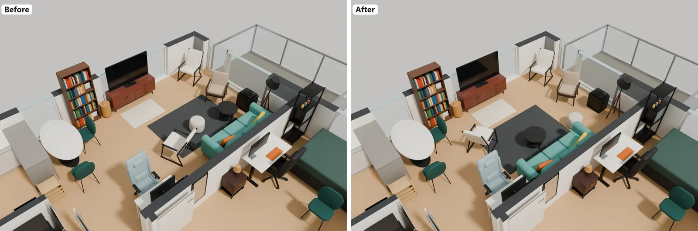
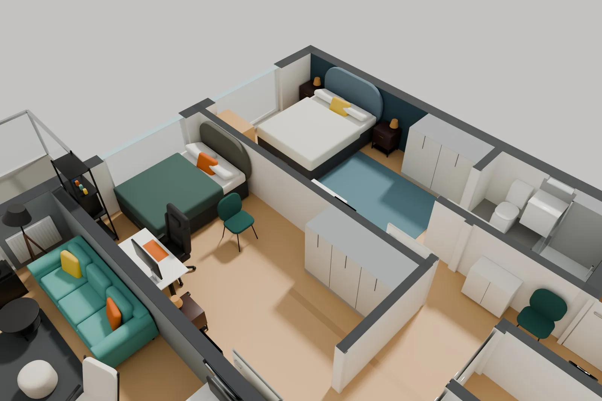

I wanted to try a few furniture layouts without actually dragging the sofa around the flat. So I gave my AI a floor plan and 13 photos from my phone, and asked it to rebuild the whole place in 3D.

It basically got it right in one go. Now I have a 3D version of my flat where I can drag any piece of furniture around, and it tells me when something hits a wall or another piece.

A lot of you asked how I did it, so here's the prompt. You can paste it straight into Claude, ChatGPT, Codex, Antigravity or whatever you use.

## Give this to your agent

Fill in the bits in brackets, send it, and then send your floor plan and photos.

```prompt title="Turn your home into a 3D planner"
I'm going to send you a floor plan and photos of my [FLAT / HOUSE / ROOM]. Turn them into an interactive 3D model of my home that I can open in my browser.

Build it as a single HTML page (three.js is fine) and show it to me as a preview if you can.

What I want:
- Walls, doors and windows from the floor plan
- All my furniture from the photos, roughly the right size and in the right place
- I can drag any furniture around and rotate it, with a mouse or my finger
- Furniture turns red if it hits a wall or another piece
- A top-down view and a 3D view
- Leave out clutter like [CLOTHES, BAGS, PLATES], but keep all the furniture

For the size: [ONE REAL MEASUREMENT, e.g. "the living room is 4.2 m wide" or "the total area is 70 m²"].

If the floor plan and the photos don't match, trust the photos.

Wait until I've sent the floor plan and all the photos, then build it.
```

## What you need

- A floor plan. A screenshot from the listing or your rental ad is fine, even without room sizes.
- Photos of every room from your phone, one or two angles each. No need to tidy up first.
- Any AI chat app. Ones that can show a live preview, like Claude or ChatGPT, are the easiest.
- Optional: one real measurement, like the length of one wall. It makes the sizes a lot more accurate.

## Steps

1. Copy the prompt and fill in the brackets.
2. Send it, then send the floor plan and the photos.
3. Open the preview and start moving things around.
4. If something looks off, just tell it, like "the sofa should be against the other wall", and it'll fix it.

## Result

Here's the kind of thing I wanted it for. I moved the sofa so it's centred on the TV, took the rug and coffee table with it, and moved an armchair next to the dining table. Nothing turned red, so I know it all fits before lifting anything.




It did the bedrooms and bathrooms too, with the walls cut at waist height so you can see inside, like a dollhouse.



Honestly it's actually fun to just play around with. And if you're buying a new wardrobe or desk, you can check if it fits before you order it.
