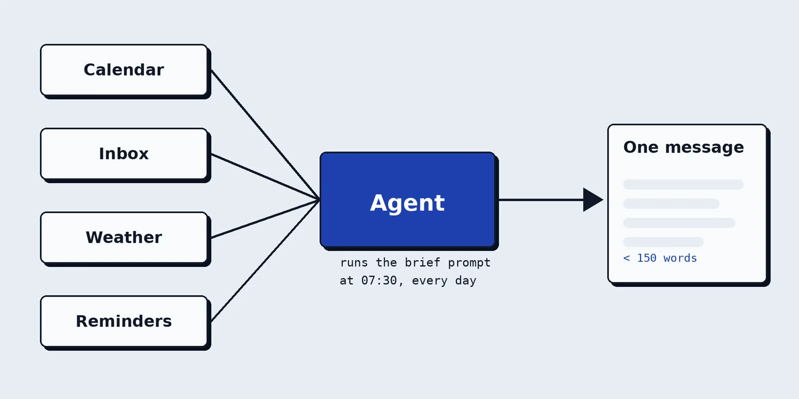

> Demo post. It shows the Builds format for review and stays a draft. The setup is generic on purpose.

Every morning at 07:30 I get one message. It tells me the one thing that matters today, then the meetings, the emails that need a reply and anything I asked to be reminded about. It takes under a minute to read, and I stopped opening four apps before breakfast.

You can build the same thing in an evening. The prompts below do most of the work.

## Give this to your agent

The first prompt sets the whole thing up with a coding agent. The second is the prompt the agent runs every morning.

```prompt title="1. Set up the morning brief"
You are setting up a daily "morning brief" for me. Work step by step and check with me before anything that sends messages or needs a password.

Goal: every day at [TIME, e.g. 07:30] in [YOUR TIMEZONE], send me one short message on [WHERE: Telegram, Slack or email] that covers:
1. Today's calendar: meetings with times, and anything I need to prepare.
2. Inbox: up to 5 emails that need a reply from me today. Skip newsletters, receipts and notifications.
3. One line on the weather for [YOUR CITY].
4. Anything I asked you to remind me about.

Rules:
- Keep the whole message under 150 words. Lead with the single most important thing.
- If a source fails, say which one in one line and send the rest anyway.
- Never include passwords, login codes or full email bodies.
- Keep API keys in environment variables or a secret store, never in code or in chat.

Deliverables:
- A scheduled job that builds and sends the brief.
- A dry-run command that prints today's brief without sending it.
- A short README: how to change the time, the sources and where it sends.

Start by asking me which calendar, inbox and chat app I use. Then propose a plan before writing any code.
```

```prompt title="2. The daily brief prompt"
Write my morning brief for today from the data below.

Format:
- First line: the one thing that matters most today, and why, in one sentence.
- Then up to four short sections: Calendar, Replies needed, Weather, Reminders. Leave out any section that is empty.
- Plain text. Under 150 words.

If something looks urgent (a meeting moved, a deadline today, a reply someone is waiting on), put it first.

Data:
[PASTE OR PIPE IN TODAY'S CALENDAR, EMAILS AND REMINDERS]
```

## What you need

- A coding agent: Claude Code, Codex, ChatGPT or similar
- A machine that is on at 07:30, or any service that can run a scheduled job
- Read access to your calendar and inbox (an API token or an app password)
- A chat app the agent can send to, such as Telegram, Slack or email
- About two hours, most of it connecting accounts

## How it works



The agent never browses on its own. A small script collects the raw data, then hands it to the model with the daily brief prompt. That split matters: the script is boring and testable, and the model only does the writing.

| Section | Source | Limit |
| --- | --- | --- |
| Top line | Everything below | 1 sentence |
| Calendar | Calendar API | Today only |
| Replies needed | Inbox search | 5 emails |
| Weather | Any weather API | 1 line |
| Reminders | A plain text file | All open items |

## Steps

1. Pick where the brief arrives first. It decides the format: Telegram and Slack handle short lines well, email wants a subject line.
2. Paste prompt 1 into your coding agent and answer its questions. Let it propose the plan before it writes code.
3. Connect one source at a time and run the dry run after each. Fix a source before adding the next.
4. Run the dry run for three mornings before you let it send anything.
5. Schedule it. A cron entry is enough:

        # every day at 07:30, in the machine's local time
        30 7 * * * ./morning-brief --send

6. After a week, cut whatever you never read.

## What didn't work

- **"Tell me everything important."** The first version wrote 600 words. A hard word limit and "lead with one thing" fixed it.
- **Newsletters in the inbox section.** The model treated them as mail that needs a reply. An explicit skip list solved it.
- **One flaky source killed the whole brief.** The weather API timed out and nothing arrived. Now a failing source gets one line and the rest still sends.
- **Times in UTC.** Meetings showed up an hour off. Set the timezone in the schedule and in the prompt.

## Result

One message at 07:30, usually 100 to 150 words. I read it before I open anything else, and most days I don't open the calendar until my first meeting.
